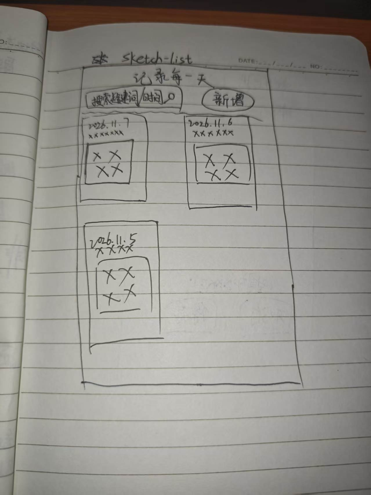
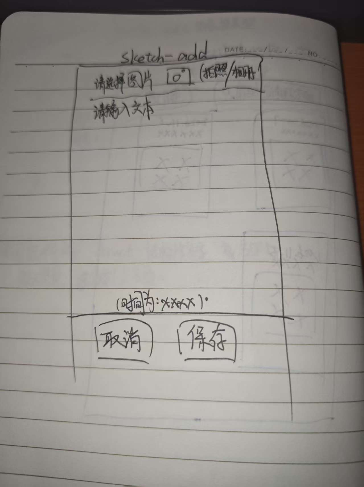
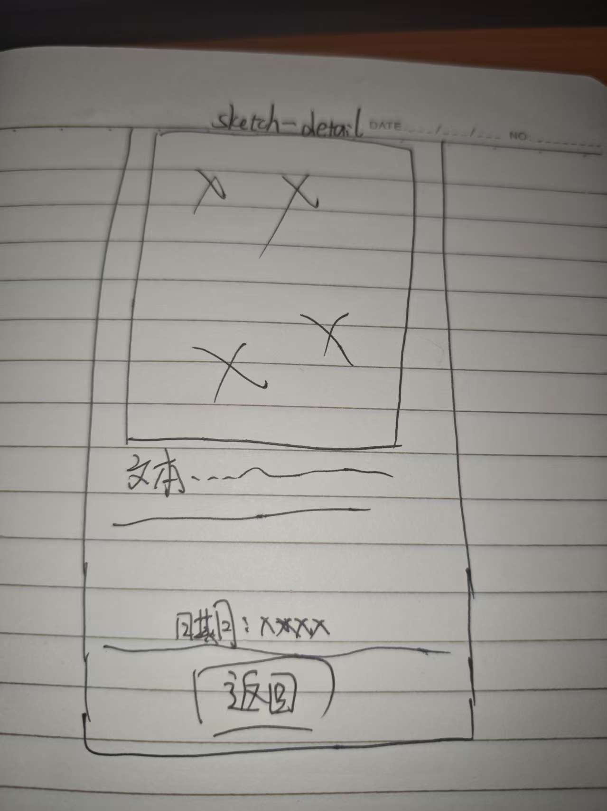

# 照片日记 · 需求说明

一句话 + 一张照片 + 时间，记录每天的生活。（记录每天的生活，让以后的自己看看，回想起现在的美好时刻）

## 用户能做什么
- 打开首页，看到按时间排列的日记卡片列表
- 新增/删除 一条日记
- 提交/保存 日记

## 一条日记包含什么
| 字段 | 说明 |
|---|---|
| 文字 | 用户自己手打 |
| （图片） | 用户可以通过拍照或者从相册里提交照片 |
| （时间） | 自动填充当天的年月日几时几分 |

## 三个页面长什么样
### 列表页

### 新增页

### 详情页

